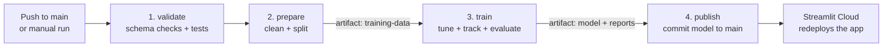
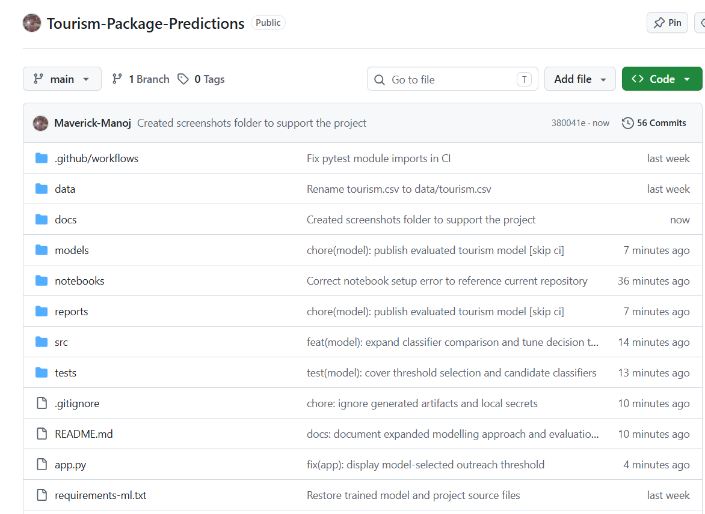
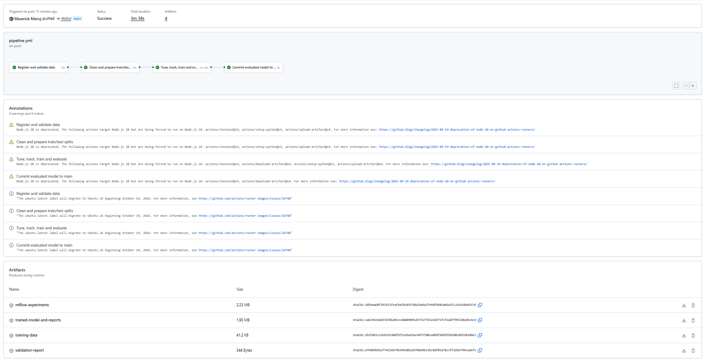
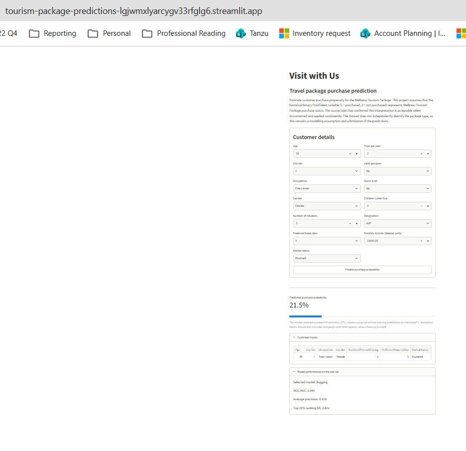

# Tourism Package Prediction

[](https://github.com/Maverick-Manoj/Tourism-Package-Predictions/actions/workflows/pipeline.yml)
[](https://tourism-package-predictions-lgjwmxlyarcygv33rfglg6.streamlit.app/)

An automated MLOps pipeline for **Visit with Us** that predicts, before a customer is contacted, whether they will buy the new Wellness Tourism Package. A GitHub Actions workflow validates the data, prepares train and test splits, tunes and tracks six classifiers, commits the best model back to `main`, and the Streamlit app serves it.

**Live app:** https://tourism-package-predictions-lgjwmxlyarcygv33rfglg6.streamlit.app/

## Business problem

Choosing which customers to call by hand is slow, inconsistent and error-prone, so good prospects are missed and campaign effort is wasted. A model that scores customers before contact lets the marketing team call the most promising people first and retrain as customer behaviour changes.

## Modelling assumption

The dataset has one binary target, `ProdTaken` (1 = purchased, 0 = not purchased). It does not separately identify Wellness Tourism Package purchases, so this project treats `ProdTaken` as the Wellness package purchase flag. The course team confirmed this is acceptable when documented. It remains a limitation: results describe historical package purchases and should be confirmed against package-specific records before operational use.

## Pipeline



| Job | What it does | Output |
|---|---|---|
| `validate` | Checks expected columns, target values and unique IDs, prints a data summary, runs the test suite | `reports/data_validation.json` |
| `prepare` | Cleans categories, drops unusable columns, makes a stratified 80/20 split | `build/train.csv`, `build/test.csv` (workflow artifact) |
| `train` | Loads the artifact, tunes six algorithms with cross-validation, logs every trial to MLflow, picks the best model and decision threshold, re-scores the saved model independently | `models/best_model.joblib`, `reports/metrics.json`, `reports/experiments.json` |
| `publish` | Commits the evaluated model and reports to `main` (`[skip ci]` avoids a loop) | Updated model in the repository |

The workflow runs on every push that changes `data/`, `src/`, `tests/`, the workflow file or the requirements files, and can also be started manually with **Run workflow**.

## Modelling approach

- **Features (13):** age, city tier, occupation, gender, travellers, preferred hotel stars, marital status, trips per year, passport, car ownership, children under five, designation and monthly income.
- **Excluded on purpose:** `CustomerID`, `TypeofContact`, `DurationOfPitch`, `NumberOfFollowups`, `ProductPitched` and `PitchSatisfactionScore`. These describe the sales interaction, which has not happened yet at prediction time, so using them would leak information the model will not have.
- **Cleaning:** `Fe Male` becomes `Female`, `Unmarried` becomes `Single`, missing values are imputed inside the model pipeline (median for numbers, most frequent for categories) so training and serving behave identically.
- **Algorithms compared:** Decision Tree, Bagging, Random Forest, AdaBoost, Gradient Boosting and XGBoost, each tuned with a grid search and 3-fold stratified cross-validation.
- **Selection metric:** average precision (PR-AUC), because only about 19% of customers purchased and plain accuracy would be misleading.
- **Decision threshold:** chosen from out-of-fold predictions on the training split by maximising F1, so the test set is never used to pick the model, its parameters or its cutoff.
- **Experiment tracking:** every tuning trial and the final model are logged to MLflow, and all trials are saved to `reports/experiments.json`.

## Results

<!-- Refresh these from reports/metrics.json whenever the model is retrained. -->

| Metric (held-out test set, 826 customers) | Value |
|---|---|
| Selected model | Bagging |
| ROC-AUC | 0.942 |
| Average precision | 0.818 |
| Precision / recall at tuned threshold (0.37) | 0.753 / 0.748 |
| Customers flagged at that threshold | 19.1% |
| Lift in the top 20% of scores | 3.8x |

Cross-validated average precision: Bagging 0.760, Gradient Boosting 0.760, Random Forest 0.753, XGBoost 0.741, AdaBoost 0.596, Decision Tree 0.571. The top three are within normal cross-validation noise of each other.

## Repository layout

```
.
├── .github/workflows/pipeline.yml   # CI/CD pipeline
├── app.py                           # Streamlit application
├── data/tourism.csv                 # Raw dataset
├── models/                          # Committed model + metadata (written by the pipeline)
├── notebooks/tourism_mlops.ipynb    # Walkthrough notebook
├── reports/                         # Validation report, metrics, experiment log
├── src/
│   ├── common.py                    # Columns and cleaning
│   ├── validate_data.py             # Data registration / validation
│   ├── prepare_data.py              # Clean + split
│   ├── train_model.py               # Tune, track, select, save
│   └── evaluate_model.py            # Independent check of the saved model
├── tests/                           # Pytest suite
├── docs/screenshots/                # Evidence images used in the notebook
├── requirements.txt                 # App runtime dependencies (Streamlit Cloud)
└── requirements-ml.txt              # Training and CI dependencies
```

## Run it locally

Use Python 3.11 from the repository root.

```bash
python3.11 -m venv .venv
source .venv/bin/activate
python -m pip install -r requirements-ml.txt

python -m src.validate_data     # check the data
python -m pytest -q             # run the tests
python -m src.prepare_data      # writes build/train.csv and build/test.csv
python -m src.train_model       # tunes, tracks and saves the model
python -m src.evaluate_model    # re-scores the saved model on the test split
streamlit run app.py            # open the app
```

Set `MLFLOW_ALLOW_FILE_STORE=true` before training if your MLflow version asks for it.

## Deployment

The app is deployed on Streamlit Community Cloud from `app.py` on the `main` branch, using `requirements.txt`. Each time the pipeline commits a new model, Streamlit Cloud redeploys the app with it.

## Evidence

| Folder structure | Executed workflow | Streamlit app |
|---|---|---|
|  |  |  |

## Limitations

- The target is assumed to represent Wellness package purchases (see above).
- Predictions describe associations in historical data and do not prove that contacting a customer causes a purchase. A small controlled pilot is the right way to measure real uplift.
- Monthly income is in the dataset's own units.
- The model should be retrained as new customer data arrives; the pipeline is built for that.